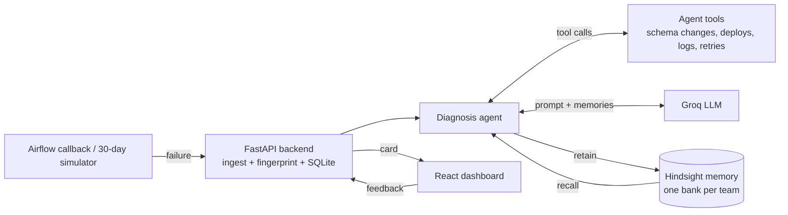

# Architecture

## Flow
1. Ingest -> 2. Fingerprint -> 3. Recall -> 4. Diagnose (tools) -> 5. Feedback -> retain -> 6. Reflect.

## Ports
| Service | Port |
|---|---|
| Frontend | 5173 |
| Backend (Swagger at /docs) | 8000 |
| Hindsight API / UI | 8888 / 9999 |
| Airflow (optional) | 8080 |
